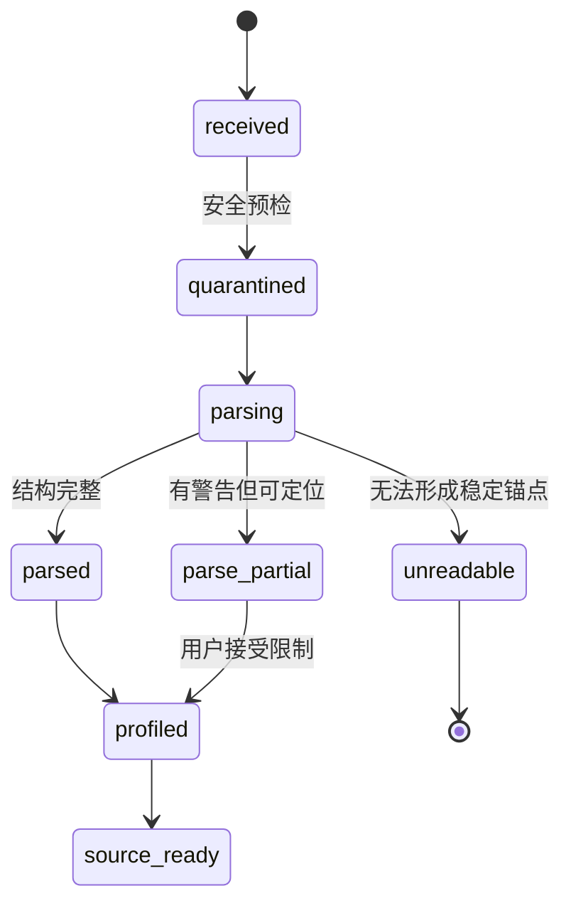
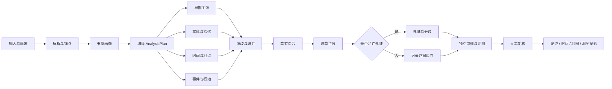
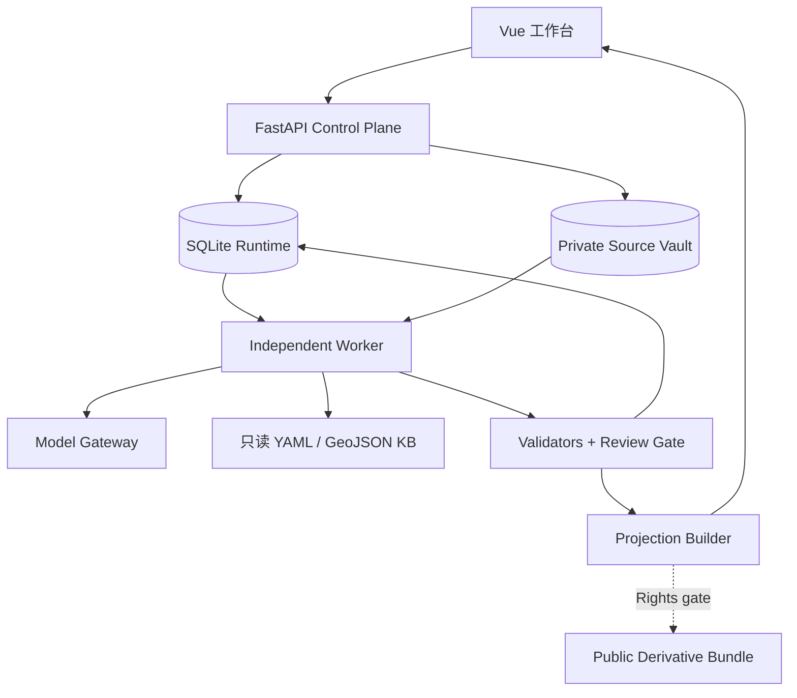

# v6 后端 Agent 架构：从一本书到可核验的历史探索

> 状态：开发级设计已通过，Phase A、Phase B 与 Phase C 的可靠性骨架已实现；真实模型质量、丰富的专属领域产物、外证评测与多租户仍按本文后续阶段推进。本文承接 `docs/workflows/book-to-exploration.md` 的 v5 产物合同，解决“谁来执行、怎样恢复、如何按书型路由、如何降低幻觉、怎样投影到论证 / 时间 / 地图 / 洞见”的问题。

## 0. 一句话决策

后端不是一个“读完整本书后自由发挥”的总 Agent，而是一个**证据优先、状态可恢复的受控工作流编译器**：先把书解析为稳定来源锚点，再根据书型生成有界 DAG；专业 worker 只提交候选，验证器和人工复核决定哪些候选能进入论证图、时空图与公开投影。

这带来五条不可退让的边界：

1. 原文、作者判断、平台推断、外部材料必须分层保存，不能在摘要里混成同一种“事实”。
2. 每个可见结论都能回到来源锚点或明确的派生链；没有来源的内容只能是问题或缺口。
3. 书型决定运行哪些 pass，不是让一个 Agent 自己临场决定所有步骤。
4. Scene、时间轴、地图和洞见是**派生投影**，不是新的真相源。
5. 工作流可以暂停、恢复、重跑和局部升级；模型失败不能让整本书从头再来。

## 1. 设计基线与当前落地

### 1.1 设计开始时已经正确的部分

- EPUB 作为不可信 ZIP 处理，已有压缩体、展开体、条目数、单项大小、XML/路径等边界。
- TXT / Markdown / EPUB 已能生成章节、段落和稳定 locator；当时私人正文仅在有界进程内存中存在。
- v5 Artifact 已区分 `source_statement / author_judgment / platform_inference / external_evidence`。
- Prompt 和书籍入口互斥；Prompt 不伪造书籍章节。
- `book_argument_graph.v1` 已有结构化输出 Schema、认识论层级、来源 anchor 和“不强造反方 / 不猜地点与因果”的 guardrail。
- 公开投影已有原文、私人 locator、凭据、可重构摘要、外部权利、人工批准六道硬闸门。
- 正式 YAML / GeoJSON 仍是只读历史底座，探索层不会直接写回。

### 1.2 设计开始时的核心缺口

| 缺口 | 当前证据 | 后果 |
|---|---|---|
| 没有真实执行器 | `analysis_queue` 固定为 `needs_model / not_called` | 只能排队，不能拆书 |
| 没有持久化作业 | `ExplorationStore` 是 6 小时 TTL 的进程内字典 | 重启丢失，无法长文本恢复 |
| 没有书型画像 | 所有导入书籍进入同一结构 | 论著、传记、史料集会被同一种 Prompt 生硬处理 |
| 没有跨章节综合 | 只有 anchor 批次合同 | 无法形成全书主线与论证层级 |
| 没有外证执行 | v5 只有 source / gap 结构 | 无法验证事实候选或检索真实分歧 |
| 没有自动评测 | 只有 Pydantic / JSON Schema 结构检查 | 结构正确不等于历史内容可靠 |
| 没有运行溯源 | 未记录 prompt、模型、输入集合、attempt、token、成本 | 结果无法复现、比较或归责 |
| 生命周期混层 | v5 业务生命周期与当前 queue 状态未连接 | “分析到哪了”和“产物能否发布”无法独立表达 |

另有两项实现前合同债务，现已完成：

- 当前 `ArgumentGraph` 强制每张图都包含六类节点，会诱导简单材料也被填满固定模板；v6 改为按书型选择图模板，只强制来源、认识论层级和限制说明。
- v5 JSON Schema 的 `entityCandidate` 残留一个引用 `geometry_status / longitude / latitude` 的无效条件块；这些字段属于地点对象，应移除这段复制残留并增加 Schema 自测。

### 1.3 2026-08-01 已落地

- `backend/app/exploration/` 已拆出合同、形态信号、画像、计划、存储、runtime、worker、模型网关、专业 pass、验证器与投影，不再把长任务堆进 `exploration_service.py`。
- 本地 private vault 保存原文件和完整解析快照；SQLite WAL 保存脱敏 control plane、run、work item、attempt、checkpoint、artifact revision、复核决定与幂等键。重启可恢复，明确删除才清除。
- 七类 BookProfile 会编译不同 DAG；单段、anchor batch 与运行时 packet 都有字符上限。worker 独立于 HTTP，并支持租约过期、retry、暂停、恢复、取消与持久 `waiting_review`。
- 模型网关支持 `none`、deterministic fixture 和 OpenAI-compatible structured output。默认 `none`，配置缺失或调用失败形成 Gap，绝不静默假装分析成功。
- claim / event 候选经来源、认识论、引用依赖、时间地点与质量门后，必须由用户逐项接受或拒绝；只有 reviewed candidate 才能进入论证、时间、地图与洞见投影。
- 本机《安史之乱》EPUB 已通过不输出正文的解析 → 全书形态信号 → 书型画像 → DAG 编译回归；私人路径与正文不进入仓库或测试输出。

当前仍未完成的是“内容质量上限”而不是运行骨架：真实 provider benchmark、gold set、跨章深综合、人物指代 / 史料边界专属产物、授权公网外证和多租户托管都保持显式未完成。

## 2. 外部调研：采用什么，不采用什么

| 项目 / 研究 | 可借鉴部分 | 本项目的决定 |
|---|---|---|
| [Microsoft GraphRAG](https://microsoft.github.io/graphrag/index/overview/) | 从文本提取实体、关系、claims，再形成多层社区报告；输出表保留 text unit 反向引用 | 借鉴“分层产物 + 来源单元”模型；不直接引入完整 GraphRAG，因通用图谱成本高、claim 语义不适配史学认识论，且官方也提示索引昂贵 |
| [LangGraph](https://docs.langchain.com/oss/python/langgraph/overview) | typed state、checkpoint、interrupt、subgraph、失败恢复、并行节点 | 作为 v6 首选编排运行时；图状态只存 ID 和控制信息，历史产物仍由本项目合同管理 |
| [Temporal](https://docs.temporal.io/) | 崩溃后恢复、长时工作流、事件历史、activity retry | 作为可靠性上限和未来迁移目标；v6 首版不引入独立 Temporal 服务，避免过早增加运维面 |
| [RAPTOR](https://arxiv.org/abs/2401.18059) | 段落到高层摘要的树状组织与多层检索 | 借鉴层级综合，但任何摘要节点必须保留 `derived_from_ids`；摘要不能取代底层证据 |
| [Lost in the Middle](https://arxiv.org/abs/2307.03172) | 长上下文中部信息利用显著下降 | 禁止“把整本书塞进长上下文”；固定采用分层 map-reduce、位置扰动回归与按需回源 |
| [Docling](https://docling-project.github.io/docling/concepts/docling_document/) | 统一文档树、阅读顺序、元素 provenance、EPUB/PDF/OCR 等格式 | 当前 EPUB 解析器继续使用；进入 PDF/OCR 阶段时优先以 Docling 作为适配器，不自造版面模型 |
| [BookNLP](https://github.com/booknlp/booknlp) | 书级实体聚类、指代、引语说话人、事件 realis 分层 | 借鉴任务拆分与“事件是否真实发生”的模态意识；不直接使用其英文文学模型处理中文历史著作 |
| [HeidelTime](https://github.com/HeidelTime/heideltime) | 中文时间表达候选与 TIMEX3 标准化 | 可作为确定性时间候选基线；帝王年号、农历、相对年代仍由本项目规则和复核处理，不能直接当最终日期 |
| [FActScore](https://arxiv.org/abs/2305.14251) / [SAFE](https://arxiv.org/abs/2403.18802) | 把长回答拆成 atomic facts，再逐项判断是否有来源支持 | 质量门采用“原子主张”而非整段打分；外网搜索只用于获授权的外证 pass，不替代原书忠实度检查 |
| [RAGChecker](https://arxiv.org/abs/2408.08067) | 分开诊断 retrieval 与 generation，测上下文利用、噪声敏感和 claim 级支持 | 建立按阶段可归因的评测，不用一个总分掩盖是检索漏了还是生成编了 |
| [DSPy](https://dspy.ai/) | 用带标签数据和指标优化结构化 LM 程序 | 先积累 gold set，再引入离线优化；没有标注集前不允许“自动优化 Prompt”自我循环 |
| [W3C PROV-O](https://www.w3.org/TR/prov-o/) / [OpenTelemetry](https://opentelemetry.io/docs/specs/otel/overview/) | Entity–Activity–Agent 派生链；跨服务 trace context | 数据溯源采用轻量 PROV 映射；运行观测采用 OTel，但 trace 中只放 ID、耗时、token 和状态，不放私人正文 |

核心结论不是“安装一套热门框架”，而是组合三类成熟思想：

- LangGraph 负责**流程恢复**；
- history-kb 合同负责**史学与证据语义**；
- FActScore / RAGChecker 式评测负责**逐项找错**。

## 3. 三套正交状态机

当前 v5 的 `lifecycle_state` 应保留，但不能再承担所有状态。v6 将状态拆成三套，避免“任务失败”和“历史结论不可靠”混为一谈。

### 3.1 Source 状态：这份材料能否被可靠读取



Source 状态只说明解析与 locator，不说明内容真实，也不说明可以公开。

### 3.2 Run 状态：这一轮分析执行到哪里

`planned → queued → running → waiting_review → completed`

旁路状态：

- `retry_wait`：仅限超时、429、临时网络等可重试错误；
- `paused`：用户取消、预算用尽或主动暂停；
- `failed`：确定性错误、Schema 连续失败、来源损坏；
- `cancelled`：明确终止，未完成 work item 不再领取；
- `waiting_input`：确有一个只有用户能决定、且会改变范围或数据外发边界的问题。

“模型失败”不得写成 `waiting_input`；“证据不足”应形成 Gap，不得写成系统失败。

### 3.3 Artifact 生命周期：产物是否足以使用或发布

继续使用 v5：

`empty → input_ready → scope_draft → scope_confirmed → structure_indexed → analysis_proposed → evidence_audited → human_review → ready_private → publishable_derivative`

关键改变：Run 可以失败或重跑而不回退 Artifact；Artifact 只在合同条件满足后前进。一次新模型运行生成新 revision，不覆盖上一版已复核产物。

## 4. BookProfile：先识别“这是什么书”，再决定怎么拆

书型不是一个单选标签，而是一份带置信度的多维画像：

```text
BookProfile
├── primary_type
├── secondary_traits[]
├── discourse_mode[]
├── source_nature[]
├── language_register[]
├── structure_quality
├── chronology_density
├── geography_density
├── actor_network_density
├── argument_density
├── citation_density
├── locator_quality
├── rights_and_privacy
└── uncertainties[]
```

### 4.1 一级书型与路由

| 一级书型 | 识别特征 | 必跑 pass | 选择性 pass | 默认前端重心 |
|---|---|---|---|---|
| `event_narrative` 事件叙事 | 时间推进明显、地点和行动密集 | 事件、时间、地点、参与者、顺序 | 作者论证、外证 | 时间柱 + 地图 |
| `argumentative_monograph` 论证型专著 | 问题意识、概念、因果解释和章节论点密集 | 作者判断、论证边、限定条件、事实候选 | 地图仅在空间密度足够时 | 论证图 + 洞见 |
| `biography_microhistory` 传记 / 微观史 | 单一人物或小群体贯穿全书 | 实体消歧、指代、生命事件、关系、迁移 | 宏观外证 | 人物轴 + 地图 |
| `institutional_thematic` 制度 / 主题史 | 跨期比较、概念与制度连续性 | 概念、制度变化、阶段、比较关系 | 人物与地图按需 | 洞见 + 长时段轴 |
| `source_collection` 史料 / 文集 | 多作者、多文献、多说话者或编者 | 文献边界、说话者、日期、出处、引文归属 | 平台综合必须单独标层 | 原文 + 出处 |
| `reference_atlas` 工具书 / 图录 | 条目、表格、图版、地图为主 | 确定性结构、表格 / 图像 locator、实体候选 | 叙事综合默认关闭 | 检索 + 地图 |
| `mixed` 混合型 | 各章模式差异显著 | 先做章节级分类，再组合子工作流 | 由章节画像决定 | 动态组合 |

### 4.2 画像如何产生

1. 确定性读取元数据、目录、标题层级、注释密度、段落长度和日期 / 地名表面密度。
2. 对全书做分层抽样：开头、中部、结尾以及不同章节，不以“前 N 页”代表整本书。
3. Profiler 只输出画像和不确定性，不输出历史结论。
4. 规则编译器依据画像生成 `AnalysisPlan`；低置信但不同路由结果相近时直接采用较保守方案。
5. 只有当分类歧义会显著改变费用、材料外发或可见产品形态时，才进入 `waiting_input` 请用户决定。

## 5. 工作流编译器：画像变成有界 DAG



### 5.1 AnalysisPlan 必须是数据，不是 Prompt 文案

每个计划至少记录：

- `profile_revision`、`pipeline_version`、`prompt_bundle_version`；
- 被选中的 pass、依赖、输入单元、输出 Schema；
- source set 与模型外发边界；
- 预计 work item 数与预算上限；
- 并发上限、超时、最大 attempt、可重试错误；
- 质量门和人工中断点；
- 被明确跳过的 pass 及原因。

同一书籍 checksum + 同一计划版本应生成相同的 work item ID。重复投递只能命中已有结果或创建新 attempt，不能重复写入产物。

### 5.2 分层长文本算法

长文本不做单次总结，采用四层证据树：

```text
段落锚点
  → section observations / claims / mentions
    → chapter digest（保留子节点 ID）
      → narrative thread（跨章主线）
        → book insight / argument graph / event graph
```

- 局部 worker 只读一个受控 anchor batch 和必要的相邻上下文。
- 章节综合读结构化局部产物，并可按 ID 回取少量原文，不读整本书。
- 跨章综合读 chapter digest、候选图和高价值来源包，不读连续全文。
- 任何高层判断都必须保存 `derived_from_ids`；删除或驳回底层节点后，高层产物自动变脏并进入重算队列。
- 位置扰动测试会把相同证据放在批次开头 / 中部 / 末尾，防止“上下文够长所以可靠”的错觉。

## 6. Agent Team：专业 worker，而不是角色扮演聊天室

| Worker | 可读取 | 可产出 | 明确禁止 |
|---|---|---|---|
| `ingest_worker` | 原文件 | 文档树、anchor、警告 | 调模型、生成摘要 |
| `profile_worker` | 目录、统计、分层样本 | BookProfile、uncertainty | 输出历史事实 |
| `passage_analyst` | anchor batch、范围合同 | 原子主张、作者判断、mentions | 使用模型常识补事实 |
| `entity_resolver` | mentions、正式 KB 候选 | exact / candidate / unresolved | 自动合并歧义实体、写 YAML |
| `temporal_geo_resolver` | 时间地点 mentions、正式 KB | 规范化候选、精度、候选地点 | 猜坐标、把相对年代伪装成精确日期 |
| `thread_synthesizer` | 局部产物、章节 digest、来源图 | 论证主线、因果 proposal、限制 | 把平台结构冒充作者明示 |
| `external_evidence_worker` | 被批准的 claim、允许 source sets | 外部来源、支持 / 分歧 / 未找到 | 强行为每条主张制造反方 |
| `critic_worker` | 候选产物和证据链 | atomic claim 审计、错误分类、重做建议 | 直接发布或改写原候选 |
| `projection_worker` | 已通过闸门的领域对象 | 时间、地图、论证、洞见投影 | 产生新历史事实 |
| `release_guard` | derivative bundle、rights / review 状态 | pass / fail / unknown | 把 unknown 当 pass |

Supervisor 本身是确定性控制器：读取状态、编译 DAG、分发 work item、汇总状态。它不直接撰写历史结论，也不允许某个 worker 临时召唤无限下级 Agent。

## 7. v6 核心数据模型

### 7.1 私有来源层

- `SourceDocument`：文件 checksum、格式、版次声明、权利与保留策略；
- `DocumentNode`：章节 / 小节 / 段落 / 表格 / 图版的树节点；
- `SourceAnchor`：结构路径、spine / href、字符 offset、content hash、进度；
- `EvidenceSpan`：私有 vault 内的精确证据窗口，只以 anchor ID 对外；
- `SourcePacket`：一次模型调用获准读取的 anchor 集合与目的。

### 7.2 分析领域层

- `Claim`：statement、speaker、epistemic layer、scope、anchor / derivation；
- `Mention`：人物、组织、地点、时间、事件、概念的原始提及；
- `EntityResolution`：候选、匹配证据、冲突项、决定；
- `TemporalRef`：原文标签、标准化区间、历法、精度、锚点；
- `LocationRef`：原文地点、候选实体、几何状态、坐标来源；
- `EventCandidate`：行动、参与者、时间、地点、event modality、claim IDs；
- `ArgumentNode / Edge`：作者解释与平台综合的论证关系；
- `EvidenceRelation`：支持、补充、范围不同、方法不同、矛盾、因果 proposal；
- `Insight`：类型、适用范围、claim 集、限制、反例或 gap、认识论层级；
- `Gap`：缺 locator、歧义、外证未找到、冲突未解、权利未知。

### 7.3 运行与溯源层

- `WorkflowRun`、`WorkItem`、`Attempt`、`Checkpoint`；
- `PromptBundle`、`ModelInvocation`、`ToolInvocation`；
- `QualityReport`、`ReviewDecision`、`ArtifactRevision`；
- `ProvenanceEdge`：`used / generated / derived_from / attributed_to` 的轻量 PROV 映射。

所有模型产物都记录：输入 artifact IDs、source packet IDs、模型标识、参数、prompt 版本、输出 Schema 版本、attempt、时间、token、成本和验证结果。日志与 trace 不保存私人原文。

### 7.4 投影层

- `ArgumentProjection`：可展开并回跳的论证节点；
- `TimelineProjection`：事件主轨 + 正式 KB 参照轨；
- `MapProjection`：已核地点、顺序而非路线、缺地点清单；
- `InsightProjection`：因果机制、空间扩散、行动策略、制度连续、史学分歧、证据缺口等有类型洞见；
- `PublicDerivativeProjection`：剥离正文、私人 locator、凭据和可重构结构后的公开包。

`Scene` 从核心事实对象降为 projection aggregate：它引用 Claim、Event、Time、Location 和 Person，但不拥有独立史实。这样 UI 可以重组九幕、五幕或按人物播放，而不改底层证据。

## 8. 认识论与幻觉控制

### 8.1 四层不是四种颜色，而是四种责任

| 层 | 含义 | 最低来源要求 | 可否进入正式 KB |
|---|---|---|---|
| `source_statement` | 材料明确陈述 | 至少一个可解析 anchor | 不能直接进入 |
| `author_judgment` | 作者的解释、因果与评价 | anchor + speaker=author | 作为作者观点保存，不等于史实 |
| `platform_inference` | 系统跨段 / 跨章形成的结构 | 至少两个下层 claim 或一个明确 limitation | 只能作为平台洞见 |
| `external_evidence` | 另一独立来源的陈述 | 独立 source + locator + rights | 复核后可支持正式晋升 |

### 8.2 硬规则

- 每句可见洞见先拆成 atomic claims；每个 atomic claim 都要有支持状态。
- `model_confidence` 不作为证据。置信度由 locator 完整性、来源独立性、消歧质量、时间地点精度、审计结果组合产生。
- 同一书多个段落重复，不算多源互证。
- “未找到反证”只生成 gap；不等于主张已证实。
- 两种解释只有讨论同一命题、同一范围且不可并存时才是 `contradicts`；其他情况用 `different_scope / method_difference / supplements / narrows`。
- 外部研究 Agent 不以“凑正反观点”为目标，只在事实重要、争议显著、用户要求或证据闸门需要时运行。
- 地图只消费 `geometry_status=verified` 且有坐标来源的 LocationRef。
- 时间轴保留原文时间、标准化候选和精度；“约”“此前”“同年”不可丢失。

### 8.3 独立审稿

Critic 不复述 Synthesizer 的思路，而是完成四个检查：

1. 把产物再拆成 atomic claims；
2. 逐项寻找支持 anchor / derivation；
3. 检查 speaker、范围、时间、地点和因果强度是否漂移；
4. 把错误归因到 retrieval、extraction、resolution、synthesis 或 projection 阶段。

只有错误可归因，团队才知道该改 Prompt、检索、规则还是数据，而不是盲目换更强模型。

## 9. 稳定性、恢复与幂等

### 9.1 Checkpoint 粒度

每个 work item 完成后落盘：

- 输入 artifact revision；
- 输出候选 revision；
- 校验报告；
- 运行 provenance；
- 下一步可执行条件。

章节之间、并行 pass 之间、人工复核前都必须有 checkpoint。恢复时复用成功 item，只重跑失败或因依赖变化而变脏的 item。

### 9.2 Idempotency key

```text
sha256(
  source_checksum
  + anchor_ids
  + pass_type
  + pipeline_version
  + prompt_bundle_version
  + model_route
  + source_policy
)
```

同 key 的已成功 item 默认复用。用户要求“用新模型重做”时必须形成新 plan revision，而不是绕开幂等保护。

### 9.3 Retry 分类

- 可自动重试：429、服务端 5xx、连接超时、worker 意外退出；
- 先修复再重试：Schema 无效、引用悬空、来源包超限；
- 不重试：权利不允许、输入损坏、人工拒绝、来源不存在；
- 同一确定性失败达到上限后进入 `failed` 并保留全部证据，不降低验收标准。

## 10. 存储与部署边界

### 10.1 两类真相源并存，但职责不同

- `data/**/*.yaml` 与 GeoJSON：继续作为经过审稿的**公开历史知识真相源**，Git diff 即审稿。
- Exploration Store：保存多用户、可变、可暂停的**私人研究工作区与运行状态**，不得冒充正式 KB。

因此引入持久化数据库并不推翻现有“YAML 优先”决策；它解决的是不同问题。

### 10.2 当前本地拓扑



`workflow_graph.py` 保留了 typed state 与持久 checkpointer 的 LangGraph 壳，便于后续复杂子图；当前权威执行路径是 `ExplorationRuntime + SQLite + pipeline`，并不把“安装了 LangGraph”写成生产运行事实。只有出现需要动态子图、复杂 interrupt 或跨日编排的第二个真实场景，才把壳接成主调度器。

### 10.3 分阶段存储

**本地 v6.1**：

- SQLite WAL 保存 workspace、run、artifact 与 checkpoint；
- 本地私有目录保存原文件和证据片段，默认不进 Git；
- 独立 worker 进程，不用 FastAPI `BackgroundTasks` 承担长任务；
- 当前使用等价的 SQLite attempt / checkpoint / idempotency 语义；LangGraph `SqliteSaver` 壳已验证但尚非主执行路径；
- 没有账户时仍只允许本机模式。

**托管 v6.2**：

- PostgreSQL 保存 tenant、workspace、artifact、run 和 checkpointer；
- S3-compatible 加密对象存储保存原文件，设置 TTL 与显式删除；
- API、worker 分离部署；Postgres 行锁领取任务，首版不额外引入 Redis；
- 账户、tenant 隔离、限额、删除回执、来源外发同意；
- EdgeOne 继续托管公开静态 Demo 和只读 derivative，不承担数十分钟分析任务。

当出现多日等待、数百并发工作流、跨服务补偿或复杂定时器，再评估迁移 Temporal；v6 的 WorkItem / Attempt / idempotency 合同应让迁移无需改领域数据。

## 11. Model Gateway 与成本纪律

Gateway 对上层暴露能力而不是厂商名：

- `structured_extract`：低温、严格 JSON、局部材料；
- `cross_unit_synthesis`：高质量模型、只读结构化产物和少量回源；
- `evidence_judge`：与生成 pass 分离的审稿路线；
- `embedding`：仅对可检索单元生成；
- `external_research`：只有 source policy 允许时开启工具。

成本顺序固定：

1. 确定性解析与规则候选；
2. 轻量模型做局部结构化提取；
3. 强模型只做跨章综合和高价值歧义；
4. 外证只核验高显著、争议或用户指定的 claim；
5. DSPy 优化只在 gold set 和稳定指标建立后离线运行。

全书默认不运行全量 GraphRAG，也不为每个段落启动多个互相辩论的 Agent。并行度受 workspace、provider 和预算三层限制。

## 12. 从后端对象到四个前端模块

| 前端模块 | 允许消费 | 禁止消费 |
|---|---|---|
| 阅读 / 回跳 | SourceAnchor、公开受限 locator | 模型猜测页码、私有绝对路径 |
| 论证链路 | Claim、ArgumentNode / Edge、speaker、limitation | 无来源自由摘要、模板强制反方 |
| 时间柱 | reviewed EventCandidate、TemporalRef、正式 KB 参照 | 仅从章节顺序推断的日期 |
| 地图 | verified LocationRef、Event–Place 关系、顺序投影 | 猜测坐标、把叙事顺序画成行军路线 |
| 洞见 | typed Insight + claim IDs + limitations | 无证据“金句”、把作者判断改成平台事实 |

同一选择状态以领域 ID 联动，而不是让四个模块分别维护一套文案。用户点击洞见时，应能沿 `Insight → Claim → Anchor` 回到原书；点击地图节点时，应能沿 `Event → Claim → Anchor` 回到相同证据。

## 13. 评测与验收

### 13.1 P0 硬闸门

- 所有 ID 引用完整，Schema 与领域 validator 通过；
- 所有 source / author claim 至少一个可解析 anchor；
- 所有 platform inference 至少一个 `derived_from_claim_id`，并有 limitation 或适用范围；
- 地图坐标 100% 有正式实体或明确外部来源；
- public bundle 不含正文、私人 locator、凭据、原文件 hash 或可重构连续摘要；
- Run 重启后从最近 checkpoint 恢复；已成功 item 不重复调用模型；
- trace、日志和异常不含私人正文。

### 13.2 分阶段诊断指标

- Parse：目录 / spine 顺序、anchor 稳定性、警告召回；
- Retrieval：相关 anchor recall、噪声比例、位置敏感；
- Extraction：claim / entity / event / time / place precision 与 recall；
- Attribution：作者、引文说话者、平台推断分层准确率；
- Resolution：实体链接、地点链接、时间标准化准确率与 abstention；
- Synthesis：atomic claim support、因果强度漂移、跨章覆盖、冗余；
- Projection：可见卡片来源覆盖、地图 / 时间一致性；
- Product：用户纠正率、回跳成功率、被保存洞见比例。

这些指标分开报告，不折成一个“质量 87 分”。阈值必须由 gold set 校准，不能拍脑袋写进代码。

### 13.3 Gold Set

先建立三个小而有代表性的集合：

1. 《安史之乱》私有评测集：覆盖九幕、已定位 / 未定位 Scene、作者判断、叙事顺序与非路线边界；只保存 anchor ID 和人工标签，不进正文。
2. 公开短文本类型集：事件叙事、论证专著、传记、史料集、制度史各至少一个可再分发样本。
3. 故障集：中部证据、同名人物 / 地点、相对年代、假设语气、引文嵌套、真实分歧与“并不冲突”的双材料。

每次模型、Prompt、检索、chunk、Schema 或路由变化都跑离线回归。没有 gold set 时，不宣布 Prompt “优化”。

## 14. 隐私、安全与权利

- 原书默认 local/private；托管时必须有账户隔离、加密、TTL 和删除回执。
- 模型调用只发送 SourcePacket 中明确列出的片段；默认不发送全书。
- 外部搜索与平台 KB 是独立 source set，用户未允许就不调用。
- prompt、trace、异常、评测样本不得保存私人正文或微信读书凭据。
- 删除 source 时同步删除私有文本、embedding、缓存与未发布派生产物；审计记录只保留不可逆 ID 和删除结果。
- 公开 derivative 的 rights gate 与 v5 保持不变；“个人持有”不等于“平台可公开全文”。

## 15. 当前代码边界

没有继续把实现堆进 `exploration_service.py`。首个真实用例采用小而正交的平铺模块，等第二个 adapter 或 provider 出现后再按子包拆分：

```text
backend/app/exploration/
├── contracts.py       # Pydantic 领域合同
├── signals.py         # 本地形态信号，不产出历史事实
├── profiling.py       # BookProfile
├── planning.py        # Profile → AnalysisPlan
├── storage.py         # SQLite + private vault
├── runtime.py         # 租约、attempt、checkpoint、幂等
├── control_plane.py   # 探索与 run 的脱敏控制面
├── worker.py          # 独立进程领取 run
├── model_gateway.py   # provider 与 structured output
├── passes.py          # 有界专业 pass
├── validators.py      # 引用、认识论、时间地点闸门
├── georesolution.py   # 已审 Place 唯一命中
├── projections.py     # argument / timeline / map / insight
├── pipeline.py        # 端到端适配器
└── workflow_graph.py  # LangGraph typed-state 壳，非当前主调度器
```

模块按职责建立，不为未来可能性预制插件系统。第二个格式适配器或第二个模型 provider 出现后，再抽象公共 adapter。

## 16. 实施顺序

### Phase A · 合同与持久化骨架（已实现）

- 修 v5 Schema 债务，新增 BookProfile、AnalysisPlan、Run / WorkItem / Attempt / Provenance；
- SQLite 持久化、source vault、删除和恢复；
- 保持现有 API 兼容，新增 run 状态与流式进度；
- 模型先用 deterministic fake，证明 crash / resume / idempotency。

验收：重启服务后探索仍在；同一 work item 不重复执行；私人正文不进日志和 artifact JSON。

### Phase B · 书型路由与局部提取（骨架已实现）

- Profiler + rule compiler；
- claim / attribution / entity / time / place / event 五类 typed pass；
- 正式 KB 候选链接但不自动晋升；
- 章节级质量报告。

验收：至少三种书型生成不同 DAG；错误可以定位到具体 pass 和 anchor。

### Phase C · 跨章综合与四类投影（reviewed-only 骨架已实现）

- chapter digest、thread synthesis、argument / event 双图；
- Scene 降为 projection aggregate；
- 论证、时间、地图、洞见共用 ID 联动和回源。

验收：《安史之乱》可从私有 EPUB 重建九幕或另一种组织，不依赖手写前端常量。

### Phase D · 外证、独立审稿与评测（未完成）

- source-policy gated 外证 worker；
- atomic claim critic、RAG 分阶段指标、gold set 回归；
- 模型 / Prompt 比较和成本报告。

验收：能明确回答“错在没检索到、提取错、消歧错、综合夸大还是投影丢失”。

### Phase E · 托管多用户（未开始）

- PostgreSQL、加密对象存储、auth / tenant、限额和删除回执；
- API / worker 分离、并发控制、OTel；
- 保持 EdgeOne 公开 Demo 为 derivative-only。

验收：两个用户不能枚举或读取彼此 workspace；长任务跨部署恢复；公开环境仍不能访问私人 source。

## 17. 现在不阻塞设计、实现时再确认的产品项

以下不是当前待办，也不需要为了继续设计立即回答：

- 托管版原书默认保留多久；默认先按“仅本机”，没有明确保留策略就不开放公网上传。
- 第一批模型 provider 与单本书成本上限；Gateway 先保持 provider-neutral，测试使用 fake。
- 是否允许自动公共网络外证；默认关闭，只使用原书和现有正式 KB。
- 首批公开 gold corpus 的选择与权利；私有《安史之乱》只做本机评测，不进仓库正文。

这些选择会影响费用、隐私和可见体验，进入对应实施阶段时应带真实 benchmark 再请求决策。

## 18. 完成的定义

后端 v6 不是“模型成功返回 JSON”就完成，而是同时满足：

1. 一本书可以在中途失败后继续，而不是从头再跑；
2. 不同书型确实生成不同计划与前端重心；
3. 每个可见结论都能回源或明确标为平台推断 / 缺口；
4. 系统知道何时不确定，并能保留歧义而不是硬合并；
5. 质量问题能归因到具体阶段；
6. 私人来源、正式 KB 与公开 derivative 始终是三层不同数据；
7. 《安史之乱》不再是手工 Demo，而是这套 pipeline 的一个可重复回归样本。
