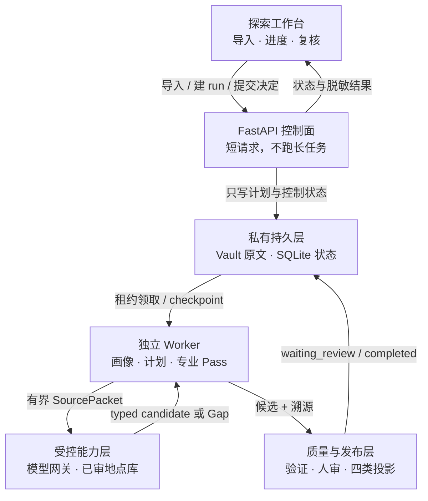
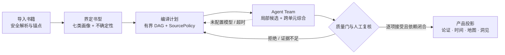
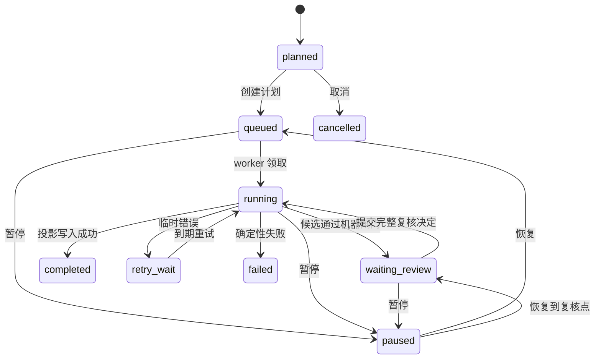

# 后端技术架构与产品流程

> 本文只描述当前仓库已经接通的 v6 骨架，并把尚未接通的能力明确标为边界。书型画像、各专业 pass 与质量规则的详细定义见 [`backend-agent-architecture.md`](backend-agent-architecture.md)。

## 1. 整体技术架构

关键边界：

- 原始 EPUB / TXT / Markdown、PDF 的本地 OCR 文本和完整解析快照只进入本机 private vault；SQLite、artifact JSON、日志和 API 列表只保存 ID、checksum、计数、状态与脱敏产物。PDF/OCR locator 仅含 PDF 页索引、可选印刷页标、OCR 状态与置信度，不接收原图路径；当前也不复制原 PDF 文件。
- HTTP 进程只负责控制面。`scripts/run-exploration-worker.sh` 才执行长任务；两者通过同一个 SQLite 状态目录协作，任一进程重启都不要求整本书重跑。
- 模型只收到当前 work item 获准的 anchor 集合；单段 ≤12,000 字、批次 ≤24 个 anchor 且 ≤36,000 字，单次运行时 source packet 另有 40,000 字硬上限。
- 模型输出只能是候选。来源锚点、认识论层、引用依赖、时间地点与投影条件由确定性校验器复核；模型给出的裸坐标不会被采信，地点只有唯一命中正式已审 Place 才能晋升。
- 正式 `data/**/*.yaml` 与 `data/geo/*.geojson` 仍是公开历史底座；探索层不自动回写。公开 Demo 使用审核过的衍生数据，不开放私人 v6 API。

## 2. 一本书怎样变成四个工作面

产品含义不是“上传后等一篇摘要”，而是：

1. **界定**：解析器先证明能稳定定位原文；Profiler 只读取本地形态信号，不先写历史结论。
2. **分派**：事件叙事、论证专著、传记 / 微观史、制度 / 主题史、史料集、工具书和混合型会得到不同 pass 组合。Supervisor 编译计划，不由总 Agent 临场无限派生子 Agent。
3. **拆解**：worker 以 anchor batch 为最小证据单元，分别提取主张、事件、人物关系、论证和限制；高层综合必须保留 `derived_from_ids`。
4. **找错**：错误按 retrieval / extraction / resolution / synthesis / projection 归因。证据不足形成 Gap；没有模型形成 `model_not_called`，都不是历史结论。
5. **定稿**：用户必须对每个 Claim / Event 显式接受或拒绝；派生项的底层依赖未接受时不能提交。通过后才生成前端四个工作面的共享 ID 投影。

## 3. 运行状态与恢复

- work item ID 与 idempotency key 由 source checksum、plan / prompt / model 版本和输入依赖共同决定；相同输入重复执行不会重复提交产物。
- attempt、租约、retry_wait 与 checkpoint 都持久化。worker 崩溃后，过期租约可以被重新领取；确定性错误不会忙循环。
- `waiting_review` 是持久停点，不是 UI 假状态。没有完整决定，worker 不会越过它；复核提交后也仍由独立 worker 完成最终投影。
- 取消不会删除原书；删除 exploration 才会清除 vault、控制状态和未发布派生产物。公开衍生发布仍受独立 rights gate 约束。

## 4. 当前实现成熟度

| 能力 | 当前状态 | 边界 |
|---|---|---|
| EPUB / TXT / Markdown 解析与稳定锚点 | 已接通 | EPUB locator 不冒充印刷页码 |
| PDF/OCR 页级来源合同 | 已接通本地 OCR 后导入 | 保留 PDF 页索引、印刷页标、OCR 状态与置信度；PDF 渲染和 OCR 执行器尚未接入 |
| 七类 BookProfile 与规则计划编译 | 已接通 | 画像是确定性形态判断，不是内容真值 |
| SQLite run / work item / attempt / checkpoint | 已接通 | 当前是本机单 workspace 运行形态，不是多租户托管 |
| 独立 worker、取消 / 恢复、幂等 | 已接通 | 单进程 worker 串行领取 run；SQLite 负责仲裁 |
| schema-first 模型网关 | 已接通合同与 MockTransport | 未用真实凭据做 provider benchmark；默认 `none` |
| 主张 / 事件候选、质量报告、人工复核 | 已接通骨架 | 真实分析深度取决于后续 provider 与 gold set 调优 |
| 论证 / 时间 / 地图 / 洞见投影 | 已接通 reviewed-only 投影 | 人物指代、史料边界和跨章复杂关系仍需扩充专属产物 |
| 公网外证 | 默认关闭 | 未经 SourcePolicy 授权不调用，也不强造“反方” |
| 从纯 Prompt 开始的研究 | 只有范围合同 | 尚未接入本书分析 worker；不得冒充已生成研究网络 |
| 公开 Demo | 已有 derivative-only 安史之乱示例 | 不由私人原文 API 提供，不下发本机 EPUB |

## 5. 代码落点

| 层 | 主要文件 |
|---|---|
| HTTP 与兼容 facade | `backend/app/api/explorations.py`、`backend/app/services/exploration_service.py` |
| 领域合同与画像计划 | `backend/app/exploration/contracts.py`、`signals.py`、`profiling.py`、`planning.py` |
| 持久化与恢复 | `backend/app/exploration/storage.py`、`runtime.py`、`control_plane.py` |
| Agent 执行 | `backend/app/exploration/worker.py`、`pipeline.py`、`passes.py`、`model_gateway.py` |
| 质量与产品投影 | `backend/app/exploration/validators.py`、`projections.py`、`georesolution.py` |
| 前端复核闭环 | `frontend/src/stores/useExplorationStore.js`、`frontend/src/components/exploration/ExplorationEvidence.vue` |
